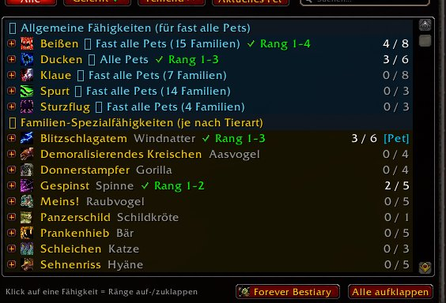

# 🦕 Dino's Pet-Skills (`DinosPetSkills`)

**by X4rinia und Dino** · *Zusatz-Addon für Forever Bestiary (Pet Hunter)*

**Dino's Pet-Skills** ist ein kompaktes Sammlungs-Addon für **WoW Forever**: Es speichert **dauerhaft für deinen Charakter**, welche durch Pets erlernbaren Fähigkeiten und Ränge dein Jäger bereits gesammelt hat – ganz egal, welches Pet du gerade aktiv bei dir hast oder ob du ein Tier längst wieder freigelassen hast.



---

## ⚠️ Voraussetzung (Abhängigkeit)

Dieses Addon benötigt **[Forever Bestiary (Pet Hunter)](https://www.curseforge.com/wow/addons/forever-bestiary-pet-hunter)** (Ordnername: `ForeverBestiaryPetHunter`, CurseForge-Projekt-ID `1712376`).
In der `DinosPetSkills.toc` ist diese Abhängigkeit fest über `## Dependencies: ForeverBestiaryPetHunter` (`RequiredDeps`) hinterlegt.

---

## 📦 Installation über WoWUp (Empfohlen)

1. Stelle sicher, dass **Forever Bestiary (Pet Hunter)** installiert ist.
2. Öffne die **WoWUp**-App.
3. Klicke auf **Addons holen** → **Von URL installieren** (*Install from URL*).
4. Füge folgende GitHub-URL ein:
   ```text
   https://github.com/x4rinia/DinosPetSkills
   ```
5. Klicke auf **Installieren**. WoWUp lädt automatisch das neueste Release herunter und hält das Addon aktuell.

---

## ✨ Features

- **Reine, übersichtliche Sammlung (`SavedVariablesPerCharacter`):**
  Im Standard-Fenster „Wildtierausbildung“ siehst du immer nur die Fähigkeiten deines *aktuell gerufenen* Pets. `DinosPetSkills` merkt sich dauerhaft alle gesammelten Fähigkeiten & Ränge deines Jägers.
- **Hervorhebung allgemeiner Pet-Fähigkeiten (`★`):**
  Fähigkeiten, die **alle bzw. fast alle Pets** lernen können (*Ducken*, *Beißen*, *Klaue*, *Spurt*, *Sturzflug*), stehen optisch hervorgehoben im eigenen Bereich **„★ Allgemeine Fähigkeiten (für fast alle Pets)“** über den **„◆ Familien-Spezialfähigkeiten“**.
- **Automatische Übernahme aus Forever Bestiary:**
  Bereits gezähmte Wildtiere aus deiner `ForeverBestiaryPetHunter`-Historie werden automatisch erkannt und ihre Fähigkeiten (inklusive niedrigerer Ränge `Rang 1–X` und Familien-Spezialfähigkeiten) direkt als gelernt markiert.
- **Direkt-Button zu Forever Bestiary:**
  Unten im Fenster öffnet der Button **`Forever Bestiary`** mit einem Klick direkt das Hauptfenster von *Forever Bestiary (Pet Hunter)*, wenn du Wildtiere oder Fundorte nachschlagen möchtest.
- **3 Schriftgrößen (`S` / `M` / `L`):**
  Oben rechts im Fenster lässt sich die Schriftgröße jederzeit in 3 Stufen umschalten.

---

## 🎮 Öffnen im Spiel

- **Chat-Befehle:** `/dinopets` oder `/dinoskills` (weitere Befehle: `/dinopets scan`, `/dinopets minimap`, `/dinopets status`)
- **Minimap-Button:** Frei verschiebbarer Dino-Button am Minimap-Rand (Linksklick: Öffnen/Schließen, Rechtsklick: Neu scannen, Gedrückt halten: Verschieben)
- **Wildtierausbildung:** Direkt-Button **`Dino's Pet-Skills`** oben rechts im Jäger-Fenster „Wildtierausbildung“
